# Digital Payment Fraud & AML Monitoring

Detects fraudulent mobile-money transactions and prioritises alerts for review, using the synthetic **PaySim** dataset. The project combines a supervised model, AML-style transaction-monitoring rules and a money-based view of what the alerts catch.

## Problem and objective

Only about 0.13% of PaySim transactions are fraud, and fraud occurs only in `TRANSFER` and `CASH_OUT`. The simulator's own rule (flag transfers over 200,000) catches very little of it. The objective is to build a model that catches as much fraud as possible within a fixed, small false-alert budget, evaluated the way a payments team would deploy it: trained on the past, tested on a later period, using only information available before a transaction completes.

## Scope: what "AML" means here

PaySim has no customer or KYC data, no sanctions lists and no case outcomes, so this is **transaction monitoring**, not a full AML programme. It covers rule-based typologies (large transfers, account drain), model-ranked alerts, destination-account history and a view of fraud money caught versus missed.

## Approach

1. **Time-based split:** train on the earliest part of the 30 days, choose thresholds on the next part (validation) and test on the final part. A random split would leak information from the same period.
2. **Features:** transaction type, amount, the sender's balance before the transaction, amount relative to that balance (an account-drain signal), merchant flag, hour and day, and destination-account history (earlier transactions received and total received, computed only from earlier rows).
3. **Leakage control:** the balance-after columns can encode the label in this simulation, so the main model uses only pre-transaction information. Models with all features and with no balance features are trained as ablations.
4. **Imbalance handling:** legitimate training rows are downsampled, and scores are corrected back to the natural class balance. Thresholds are set on the untouched validation period.
5. **Operating point:** thresholds are fixed on validation to hit a false-positive-rate budget, then applied once to the test period.
6. **Baselines:** the simulator's `isFlaggedFraud` rule, a large-transfer rule, an account-drain rule and a Logistic Regression model.
7. **Evaluation:** PR-AUC, ROC-AUC, recall at fixed false-positive rates with confidence intervals, alerts raised, and fraud amount caught versus legitimate amount flagged.

## Findings

Results from a full run on the 6,362,620-row PaySim file (`python -m src.train --data data/paysim.csv`, about 6 minutes, seed 42). Split by time: train steps 1-300 (3,401 fraud), validation steps 301-355 (562 fraud), test steps 356-743 (4,250 fraud, 1,248,736 rows). Thresholds are chosen on validation and applied once to the test period. Full numbers are in `models/metrics.json`.

| Model (time-based test period) | ROC-AUC | PR-AUC | Recall at 0.01% FPR | Recall at 0.05% FPR | Recall at 0.1% FPR |
|---|---|---|---|---|---|
| Logistic Regression (pre-transaction) | 0.9921 | 0.6632 | 0.396 | 0.561 | 0.622 |
| XGBoost, all features (leakage-prone) | 1.0000 | 0.9994 | 0.998 | 0.998 | 0.999 |
| **XGBoost, pre-transaction (final)** | **1.0000** | **0.9982** | **0.980** | **0.999** | **0.999** |
| XGBoost, no balance features | 0.9745 | 0.4973 | 0.476 | 0.488 | 0.503 |

| Rule baseline (test period) | Recall | Precision | Alerts |
|---|---|---|---|
| Built-in `isFlaggedFraud` | 0.3% | 100.0% | 13 |
| Transfer over 200,000 | 34.2% | 1.8% | 82,213 |
| Account drain (amount >= old balance) | 97.2% | 1.7% | 236,376 |

**Final model at each false-alert budget (test period):**

| FPR budget | Recall (95% CI) | Actual FPR | Precision | Alerts | Fraud amount caught |
|---|---|---|---|---|---|
| 0.010% | 98.0% (97.5%-98.4%) | 0.0089% | 97.4% | 4,275 | 100.0% |
| **0.050% (headline)** | **99.9% (99.7%-99.9%)** | 0.0535% | 86.4% | 4,910 | 100.0% |
| 0.100% | 99.9% (99.8%-100.0%) | 0.1115% | 75.4% | 5,634 | 100.0% |

- **Versus the rules:** at a 0.05% false-alert budget the model finds 99.9% of fraud with 4,910 alerts. The account-drain rule finds 97.2% but needs 236,376 alerts (about 48 times more), and the large-transfer rule finds 34.2% with 82,213 alerts. The simulator's own flag catches 0.3%.
- **Versus a linear model:** Logistic Regression reaches only 0.66 PR-AUC, so the gain comes from non-linear interactions between type, amount and sender balance.
- **Effect of the balance-after columns:** adding them changes PR-AUC only from 0.9982 to 0.9994, so the pre-transaction model gives up almost nothing and avoids the leakage risk. Removing the balance features altogether drops PR-AUC to 0.4973, so the sender's *old* balance is what carries the signal.
- **Most important features:** `amount_to_balance` (about 53% of importance), `type_TRANSFER`, `log_amount`, `oldbalanceOrg`, `type_CASH_OUT`. In other words the model has learned the account-drain pattern and refined it.
- **Quick 1M-row run (`--nrows 1000000 --n-iter 3`):** PR-AUC 0.9177, with only 63 fraud cases in its test slice and 81% recall at the 0.01% budget. It is useful as a fast check, but the wide confidence intervals (69.6%-88.8%) show why the full run is the one to quote.
- **What this does and does not show:** PaySim is synthetic and its fraud follows a simple scripted pattern (drain the account via TRANSFER then CASH_OUT), so near-perfect scores mainly show that the pipeline and evaluation are sound, not that real-world fraud would be this easy. Real fraud adapts, labels arrive late and legitimate behaviour is messier. Fraud also arrives in uneven numbers over time (562 cases in validation, 4,250 in test), so the threshold is tuned on a smaller sample than it is tested on.

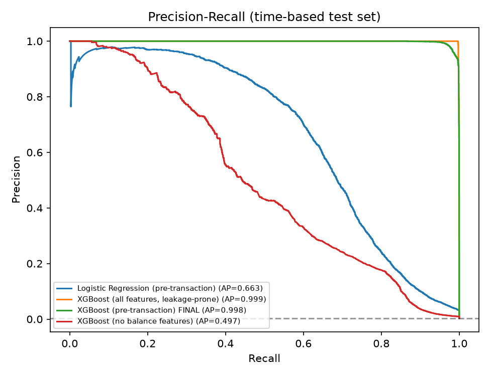
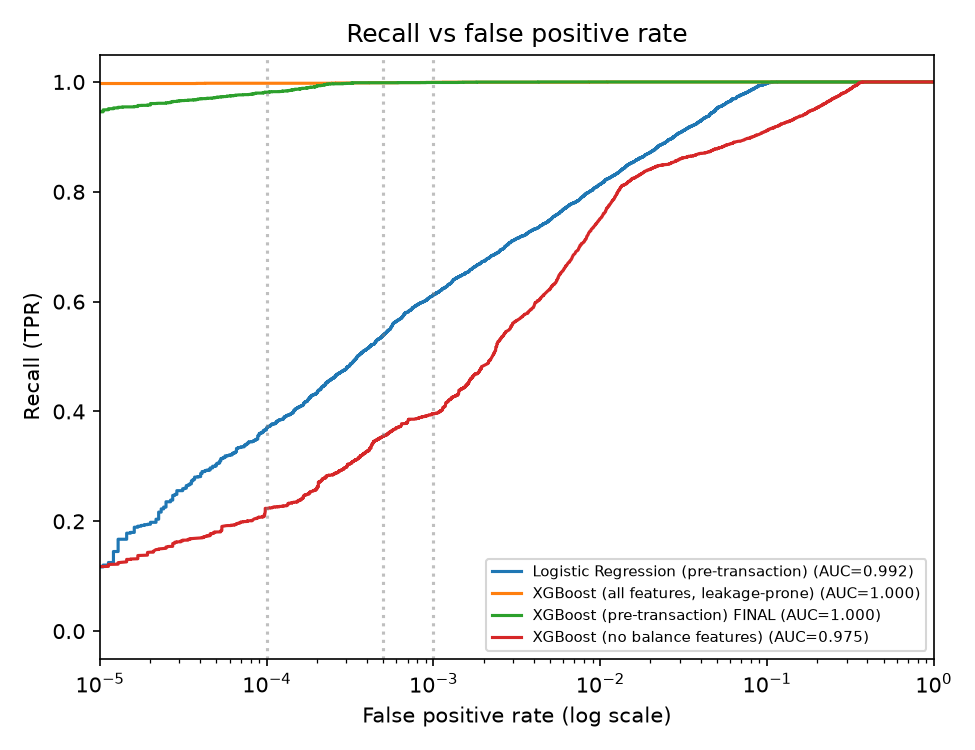
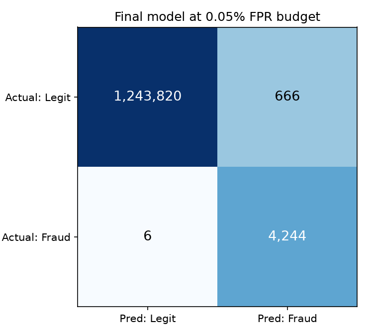
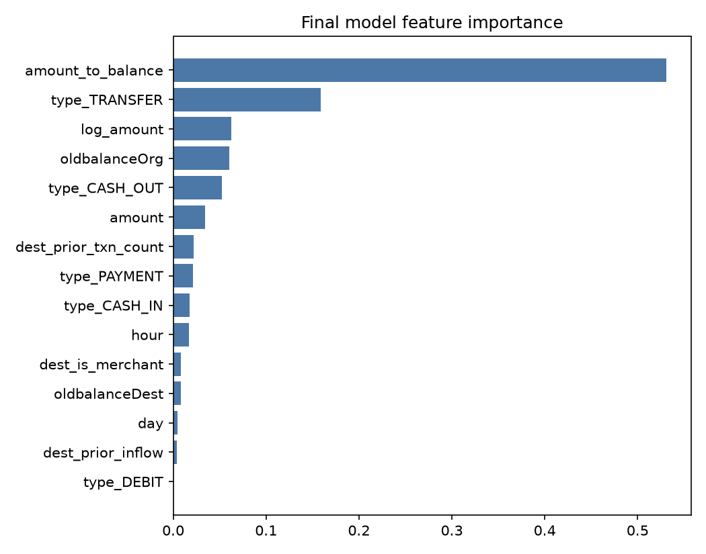
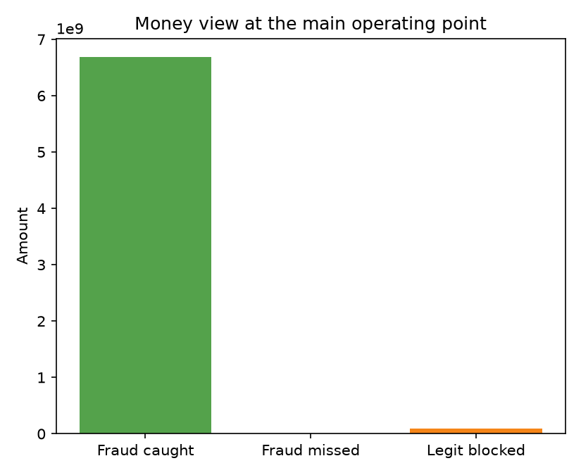
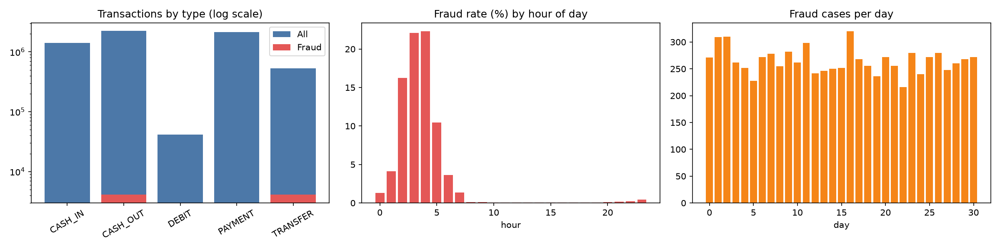

## Dashboard and app

### Interactive dashboard (Python and Plotly)

`dashboard/build_dashboard.py` builds a single HTML file, [`dashboard/fraud_aml_dashboard.html`](dashboard/fraud_aml_dashboard.html). GitHub shows HTML files as source code, so download the file and open it in a browser (it loads Plotly from the internet). The three screenshots below show it.

**Fraud overview (whole dataset).** All 8,213 fraud cases are in `CASH_OUT` and `TRANSFER`, split almost evenly. The fraud rate peaks at about 22% in the early hours (roughly 03:00-04:00) and is close to zero from 08:00 onward, and fraud is spread evenly across the 30 days.

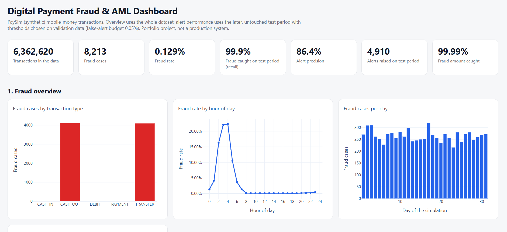

**Alert performance (test period).** The final model caught 4,244 of 4,250 frauds with 666 false alerts, which is 99.9% recall and 86.4% precision at the 0.05% false-alert budget. It caught 99.99% of the fraud amount and flagged about 94.7 million of legitimate amount.

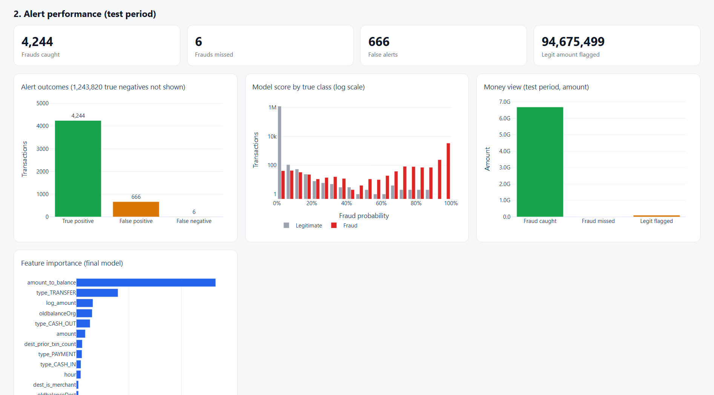

**Model vs rules.** The model needs 4,910 alerts, against 82,213 for the large-transfer rule and 236,376 for the account-drain rule. The simulator's built-in flag raises only 13 alerts.

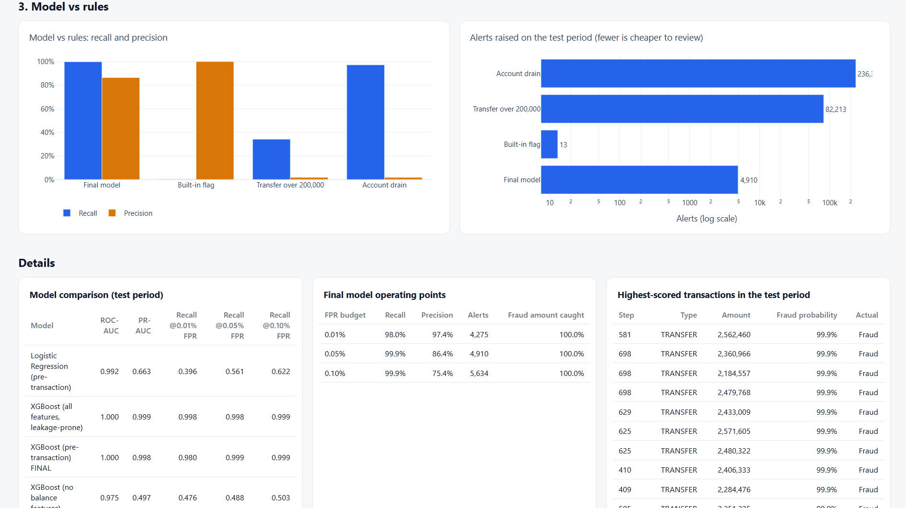

### Streamlit app

`streamlit run app.py` (or `python -m streamlit run app.py`) opens an app with three tabs: score a CSV, score a single transaction, and view model performance.

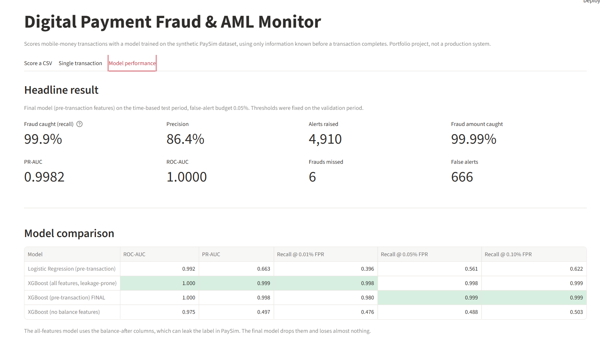

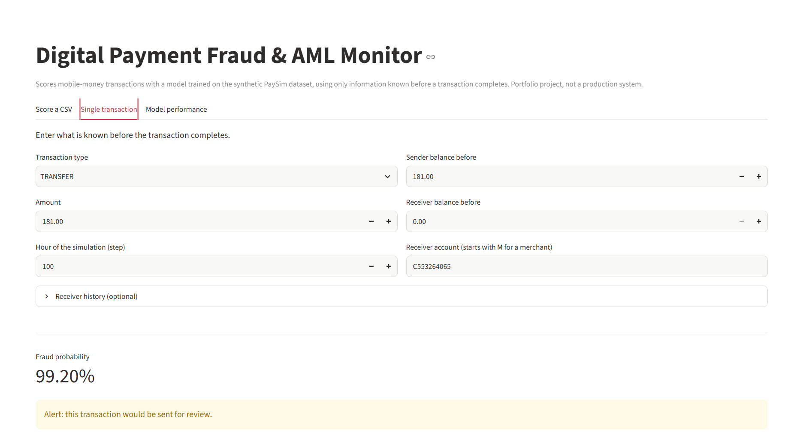

## Repository structure

| Path | Content |
|---|---|
| `README.md` | This file |
| `data/` | Dataset download instructions and schema (the raw file is not committed) |
| `notebooks/` | `01_eda.ipynb` (where fraud happens, rules, patterns) and `02_experiments.ipynb` (random vs time-based split, balance-feature ablation, operating points, rules vs model) |
| `src/` | `data.py` (loading, synthetic smoke-test data, time split), `features.py`, `models.py`, `evaluate.py`, `train.py`, `predict.py`, `config.py` |
| `models/` | Saved model, metrics and figures (generated by training) plus reproduce instructions |
| `sql/` | Schema, SQLite loader and 10 queries (fraud by type, hour and day; amount bands; account-drain pattern; existing rule performance; destination accounts; model alerts; money caught vs missed) |
| `dashboard/` | `build_dashboard.py` (interactive Plotly HTML dashboard), scored-test export script, DAX measures, Power BI layout guide and screenshots folder |
| `screenshots/` | Screenshots of the Streamlit app |
| `app.py` | Streamlit app: score a CSV, score one transaction, view model performance |
| `requirements.txt` | Python dependencies |
| `LICENSE` | MIT licence |

## How to run

Run every command from the repository root. The full dataset has about 6.4 million rows, so a machine with 8 GB of RAM or more is recommended; add `--nrows 1000000` to any command that reads the data for a quick first run.

```bash
pip install -r requirements.txt

# 1. get the data: see data/README.md

# 2. train (saves the model, metrics and plots to models/)
python -m src.train --data data/paysim.csv

# 3. SQL analysis
python sql/load_sqlite.py
sqlite3 sql/paysim.db < sql/02_fraud_by_type.sql

# 4. interactive dashboard (writes dashboard/fraud_aml_dashboard.html)
python dashboard/build_dashboard.py --data data/paysim.csv

# 4b. optional: data export for Power BI
python dashboard/export_scored_test.py --data data/paysim.csv

# 5. app
streamlit run app.py
```

Smoke test without downloading anything: `python -m src.train --synthetic --n-iter 2` (the numbers it prints are meaningless).

## Limitations and next steps

- PaySim is synthetic, so strong results here do not prove real-world performance; real fraud adapts to detection and labels arrive late.
- Sender accounts rarely repeat in PaySim, so sender-side velocity features are not informative; destination history is the only account history built.
- No graph or network features, KYC data, sanctions screening or case-management workflow, so this is not a complete AML system.
- The false-positive-rate budget is flat; a real system would weigh each alert by transaction value and investigation cost.
- No drift monitoring or explanations (for example SHAP).
- Possible next steps: graph features on account links, cost-weighted thresholds, SHAP explanations, and LightGBM or CatBoost comparisons.

## Disclaimer

Portfolio project for learning purposes. Released under the MIT licence (see `LICENSE`). It is not a production fraud or AML system.
